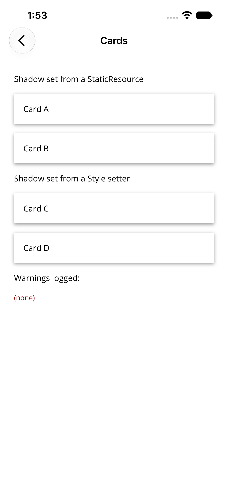
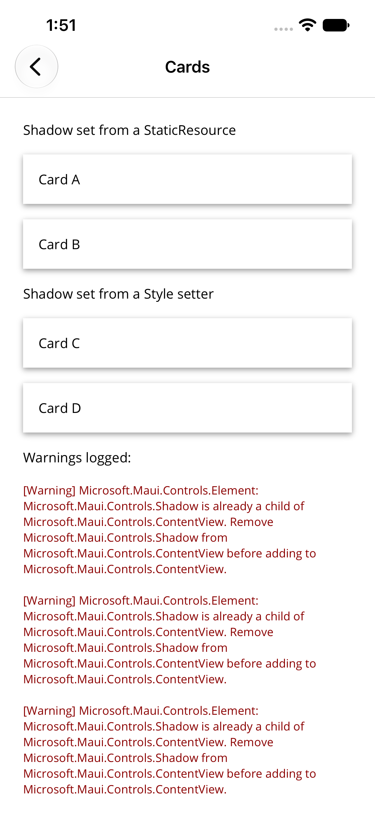

# Shared Shadow "already a child" warning repro

Since .NET MAUI 10.0.80, sharing one `Shadow` instance (keyed resource or `Style` setter) across `ContentView`s logs
`Microsoft.Maui.Controls.Shadow is already a child of ...` for each element after the first.

Run on iOS. `MainPage` pushes `CardsPage` on load; `CardsPage` lists the warnings captured by an `ILoggerProvider`.

Switch versions with `-p:MauiVersion=10.0.71` (no warnings) or `10.0.80`+ (warnings). Delete `bin`/`obj` between versions.

| 10.0.71 | 10.0.130 |
|---|---|
|  |  |
